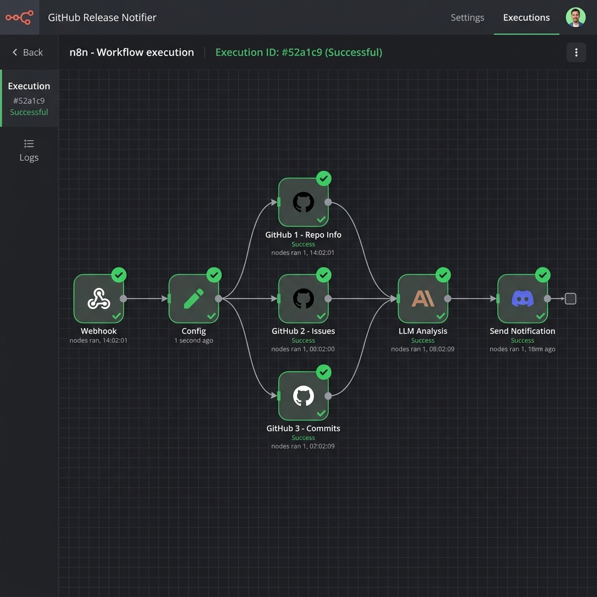

# Weekly Dev Summary Workflow (n8n + Claude)

This repository contains an exportable n8n workflow that automatically generates a weekly narrative summary of a GitHub repository's activity using Claude, and sends it via Discord webhook.

## Screenshot of Execution

## Setup Instructions

1. **Import Workflow:** In n8n, click `Add workflow` -> `Import from file` and select `workflow.json`.
2. **Configure Credentials:** Double-click the GitHub and Anthropic (Claude) nodes to configure or select your API credentials.
3. **Set Variables:** Open the `Config` node and update the `owner`, `repo`, `language` (e.g., `EN` or `FR`), and `webhook_url` (your Discord Webhook).
4. **Test Run:** Click **Execute Workflow** to test the workflow and verify the message arrives in your Discord channel.
5. **Activate:** Toggle the workflow switch to **Active** so it runs automatically every Friday at 5:00 PM.
