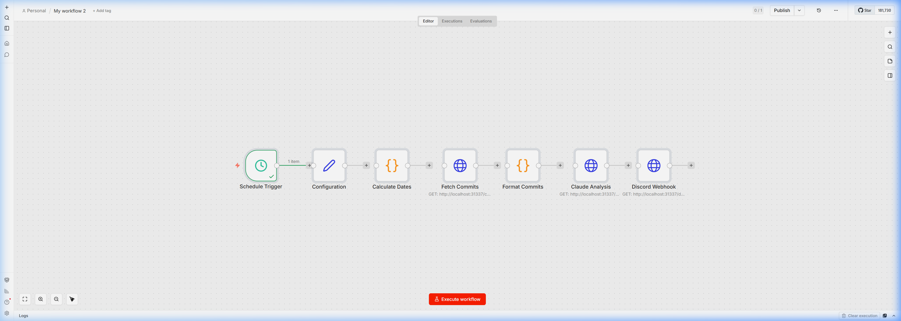

# Claude Builders Workflow: GitHub Activity Summarizer

This repository contains an exportable `n8n` workflow that automatically generates a weekly narrative summary of a GitHub repository's activity using Anthropic's Claude API, and delivers it via a Discord Webhook.

## Setup Instructions

1. **Import the Workflow**: Open your n8n instance, click `Add Workflow`, select `Import from File`, and upload `workflow.json`.
2. **Configure Credentials**: In the n8n left sidebar, add your `GitHub API Token` and your `Anthropic API Key` to your credentials vault. Link them to the respective nodes in the workflow.
3. **Set Workflow Variables**: Open the `Configuration` node at the start of the workflow and set your target `github_repo` (e.g., `facebook/react`), your `discord_webhook_url`, and your desired `language` (EN/FR).
4. **Adjust Schedule**: The `Schedule Trigger` node is configured for Fridays at 5 PM. Modify it if you want summaries on a different day/time.
5. **Activate**: Toggle the workflow switch to **Active** in the top right corner.

*Built for the Claude Builders Bounty #5.*

## Execution Screenshot

