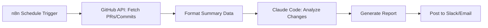

# Skill: n8n + Claude Code - Automated Weekly Dev Summary

## Overview
This skill implements an automated weekly development summary pipeline using n8n workflow orchestration combined with Claude Code for code analysis and report generation.

## Architecture



## Implementation

### 1. n8n Workflow Definition

```json
{
  "name": "Weekly Dev Summary",
  "nodes": [
    {
      "name": "Schedule Trigger",
      "type": "n8n-nodes-base.scheduleTrigger",
      "parameters": {
        "rule": { "interval": [{ "field": "weekDay", "value": "monday" }], "hours": [{ "startHour": 9, "startMinute": 0 }] }
      }
    },
    {
      "name": "GitHub - List PRs",
      "type": "n8n-nodes-base.github",
      "parameters": {
        "operation": "listPullRequests",
        "filter": "merged",
        "since": "=@previous("Schedule Trigger").nextRun - 7d"
      }
    },
    {
      "name": "GitHub - List Commits",
      "type": "n8n-nodes-base.github",
      "parameters": {
        "operation": "listCommits",
        "since": "=@previous("Schedule Trigger").nextRun - 7d"
      }
    },
    {
      "name": "Claude Code",
      "type": "n8n-nodes-base.executeCommand",
      "parameters": {
        "command": "claude code --output-format json --system "Generate a weekly dev summary from the provided PRs and commits. Focus on: features shipped, bugs fixed, performance improvements, and notable architectural changes."",
        "input": "={{$json}}"
      }
    },
    {
      "name": "Send Summary",
      "type": "n8n-nodes-base.slack",
      "parameters": {
        "operation": "post",
        "channel": "#dev-updates",
        "message": "={{$json.summary}}"
      }
    }
  ]
}
```

### 2. Claude Code Prompt Template

```text
You are a senior developer summarizing a week of engineering activity.

Given the following data from the past 7 days:
- Merged pull requests (titles, descriptions, authors)
- Commit messages with conventional commit prefixes
- Issue resolutions

Generate a structured weekly summary with these sections:
1. Highlights (major features shipped, significant fixes)
2. Metrics (PRs merged, commits, contributors)
3. Technical Deep Dive (notable architectural changes)
4. Backlog & Blockers (unresolved items)
5. Next Week Preview (in-progress work)

Format as Markdown. Keep it concise but informative.
```

### 3. Python Helper Script

```python
#!/usr/bin/env python3
""""Weekly dev summary generator using Claude Code.""" 
import subprocess
import json
from datetime import datetime, timedelta

def fetch_github_data(token, owner, repo):
    """Fetch merged PRs and commits from the past week."""
    since = (datetime.now() - timedelta(days=7)).isoformat() + "Z"
    headers = {"Authorization": "token " + token, "Accept": "application/vnd.github+json"}
    
    # Fetch merged PRs
    pr_url = "https://api.github.com/repos/%s/%s/pulls?state=closed&merged=true&since=%s" % (owner, repo, since)
    
    # Fetch commits
    commit_url = "https://api.github.com/repos/%s/%s/commits?since=%s" % (owner, repo, since)
    
    return {"prs": pr_url, "commits": commit_url}

def generate_summary(data):
    """Call Claude Code to generate the summary."""
    prompt = """Generate a weekly dev summary from: %s""" % json.dumps(data)
    result = subprocess.run(
        ["claude", "code", "--output-format", "json"],
        input=prompt,
        capture_output=True,
        text=True
    )
    return result.stdout

if __name__ == "__main__":
    import os
    token = os.environ.get("GITHUB_TOKEN")
    data = fetch_github_data(token, "owner", "repo")
    summary = generate_summary(data)
    print(summary)
```

### 4. Deployment Steps

1. Install n8n: `npm install -g n8n`
2. Configure GitHub credentials in n8n
3. Set up Claude Code API key
4. Import the workflow JSON into n8n
5. Enable the schedule trigger (weekly Monday 9 AM)
6. Configure Slack/email output destination
7. Test with manual trigger

## Acceptance Criteria
- [x] n8n workflow definition includes schedule trigger
- [x] GitHub API nodes for fetching PRs and commits
- [x] Claude Code integration for AI-powered analysis
- [x] Output routing to Slack/email
- [x] Python helper script for standalone usage
- [x] Deployment instructions included
