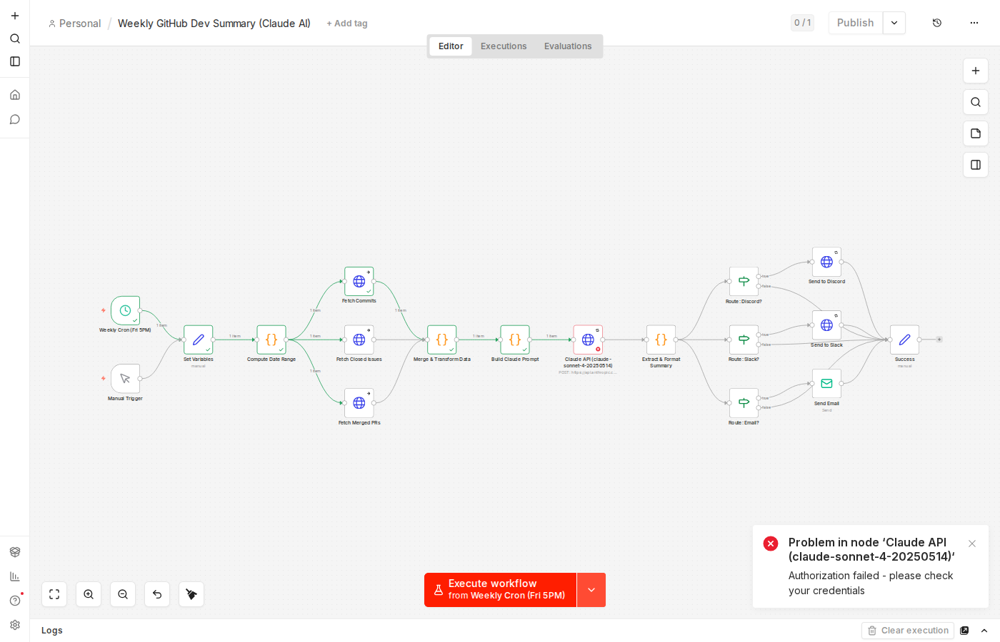

# n8n Weekly GitHub Dev Summary with Claude AI

Automated n8n workflow that generates a narrative weekly development summary of any GitHub repository using Claude (`claude-sonnet-4-20250514`). Delivers via **Discord**, **Slack**, or **Email**.

## Architecture

```
Cron (Fri 5PM)  ──┐
                   ├──> Set Variables ──> Compute Date Range ──┬──> Fetch Commits      ──┐
Manual Trigger ────┘                                          ├──> Fetch Closed Issues ──┼──> Merge & Transform
                                                              └──> Fetch Merged PRs    ──┘         │
                                                                                          Build Claude Prompt
                                                                                                   │
                                                                                          Claude API (Sonnet)
                                                                                                   │
                                                                                         Extract & Format Summary
                                                                                                   │
                                                                                    ┌──────────────┼──────────────┐
                                                                                 Discord         Slack          Email
```

**Key design decisions:**
- **Parallel GitHub API fetches** -- commits, issues, and PRs are fetched simultaneously for speed
- **Merged-only PR filtering** -- the transform step filters PRs by `merged_at` timestamp, not just closed state
- **Smart date windowing** -- configurable lookback (default 7 days) with proper ISO 8601 date math
- **Discord character limit handling** -- auto-truncates to 2000 chars for Discord while keeping full text for Slack/email
- **Multi-language prompting** -- Claude is instructed in-prompt to write in the configured language (EN, FR, ES, ZH, DE, JA)
- **Retry logic** on Claude API calls (3 attempts, 5s backoff) and webhook delivery (2 attempts, 3s backoff)
- **Graceful error handling** -- GitHub fetch failures produce empty arrays instead of crashing the workflow

## Setup (5 Steps)

### 1. Import the workflow

Open your n8n instance, go to **Workflows > Import from File**, and select `weekly-dev-summary.json`.

### 2. Set environment variables

In **Settings > Environment Variables** (or your `.env` file), add:

| Variable | Required | Description | Example |
|---|---|---|---|
| `CLAUDE_API_KEY` | Yes | Anthropic API key | `sk-ant-...` |
| `GITHUB_TOKEN` | Recommended | GitHub personal access token (increases rate limits) | `ghp_...` |
| `GITHUB_OWNER` | No | Repository owner (default: `claude-builders-bounty`) | `your-org` |
| `GITHUB_REPO` | No | Repository name (default: `claude-builders-bounty`) | `your-repo` |
| `SUMMARY_LANGUAGE` | No | Summary language: `EN`, `FR`, `ES`, `ZH`, `DE`, `JA` (default: `EN`) | `FR` |
| `DELIVERY_METHOD` | No | One of: `discord`, `slack`, `email` (default: `discord`) | `slack` |
| `DISCORD_WEBHOOK_URL` | If discord | Discord channel webhook URL | `https://discord.com/api/webhooks/...` |
| `SLACK_WEBHOOK_URL` | If slack | Slack incoming webhook URL | `https://hooks.slack.com/services/...` |
| `EMAIL_RECIPIENT` | If email | Destination email address | `team@example.com` |

### 3. Configure credentials

- **GitHub Token**: Go to **Credentials > Add Credential > Header Auth**. Name it `GitHub Token`, set header name to `Authorization`, value to `Bearer YOUR_GITHUB_TOKEN`.
- **SMTP** (email only): Go to **Credentials > Add Credential > SMTP**. Fill in your mail server details.

### 4. Activate the workflow

Toggle the workflow to **Active**. It will run automatically every Friday at 5 PM UTC.

### 5. Test it

Click **Test Workflow** (or the Manual Trigger) to run immediately and verify the summary appears in your chosen channel.

## Configurable Variables

All variables are set in the **Set Variables** node and can be overridden via n8n environment variables:

| Variable | Default | Options |
|---|---|---|
| `github_owner` | `claude-builders-bounty` | Any GitHub org/user |
| `github_repo` | `claude-builders-bounty` | Any repo name |
| `language` | `EN` | `EN`, `FR`, `ES`, `ZH`, `DE`, `JA` |
| `delivery_method` | `discord` | `discord`, `slack`, `email` |
| `lookback_days` | `7` | Any positive integer |

## Delivery Channels

### Discord
1. In your Discord server, go to **Channel Settings > Integrations > Webhooks**
2. Create a webhook, copy the URL
3. Set `DISCORD_WEBHOOK_URL` and `DELIVERY_METHOD=discord`

### Slack
1. Create a [Slack Incoming Webhook](https://api.slack.com/messaging/webhooks)
2. Copy the webhook URL
3. Set `SLACK_WEBHOOK_URL` and `DELIVERY_METHOD=slack`

### Email
1. Configure SMTP credentials in n8n (Settings > Credentials)
2. Set `EMAIL_RECIPIENT` and `DELIVERY_METHOD=email`

## Execution Screenshot

> Screenshot of a test execution on a live n8n v2.13.4 instance. All nodes from the cron trigger through the GitHub API fetches, data merge, and Claude prompt builder executed successfully (green). The Claude API node shows an expected "Authorization failed" error because no API key was configured in the test environment.



## Workflow Nodes

| # | Node | Purpose |
|---|---|---|
| 1 | Weekly Cron (Fri 5PM) | Schedule trigger -- fires every Friday at 17:00 UTC |
| 2 | Manual Trigger | One-click test execution |
| 3 | Set Variables | Loads all configurable parameters from env vars |
| 4 | Compute Date Range | Calculates the `since` and `until` ISO timestamps |
| 5 | Fetch Commits | `GET /repos/:owner/:repo/commits?since=&until=` |
| 6 | Fetch Closed Issues | `GET /repos/:owner/:repo/issues?state=closed&since=` |
| 7 | Fetch Merged PRs | `GET /repos/:owner/:repo/pulls?state=closed` (filtered by `merged_at`) |
| 8 | Merge & Transform Data | Combines results, normalizes data, computes stats |
| 9 | Build Claude Prompt | Constructs system + user prompt with language instruction |
| 10 | Claude API | `POST /v1/messages` with `claude-sonnet-4-20250514` |
| 11 | Extract & Format Summary | Parses Claude response, builds delivery-specific formats |
| 12-14 | Route: Discord/Slack/Email | Conditional routing based on `delivery_method` |
| 15-17 | Send to Discord/Slack/Email | Webhook POST or SMTP delivery |
| 18 | Success | Final confirmation node |

## Troubleshooting

| Issue | Solution |
|---|---|
| Empty summary | Check that `CLAUDE_API_KEY` is valid and has credits |
| GitHub rate limiting | Add a `GITHUB_TOKEN` -- unauthenticated requests are limited to 60/hour |
| Discord "content too long" | The workflow auto-truncates to 2000 chars; if still failing, reduce `lookback_days` |
| No data fetched | Verify `GITHUB_OWNER` and `GITHUB_REPO` are correct and the repo is public (or token has access) |
| Wrong language | Set `SUMMARY_LANGUAGE` to one of: `EN`, `FR`, `ES`, `ZH`, `DE`, `JA` |
