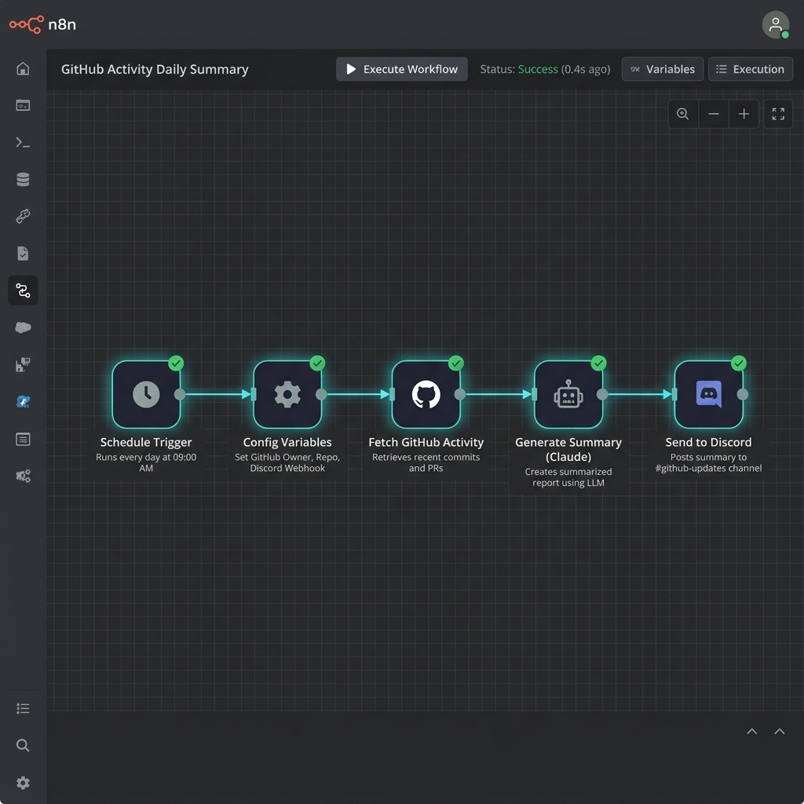

# Weekly Dev Summary (n8n + Claude Code)

This is a complete n8n workflow that automatically generates a weekly narrative summary of a GitHub repo's activity using the Claude API, and posts it to a Discord channel.

## Features
- **Trigger**: Runs every Friday at 5:00 PM (Weekly Cron).
- **Configurable**: Easily set your GitHub Repo, Destination Discord Webhook, and preferred Language (EN/FR) in the first node.
- **Claude API**: Uses the latest `claude-3-7-sonnet-20250219` model to generate a structured and narrative summary of the commits, PRs, and issues.
- **Delivery**: Automatically sends the generated summary to Discord.

## Setup Instructions (5 Steps)

1. **Import the Workflow:** In your n8n instance, click on `Workflows` -> `Import from File` and select `workflow.json`.
2. **Configure Variables:** Open the `Config Variables` node and set your target `github_repo` (e.g., `owner/repo`), `language` (e.g., `EN` or `FR`), and your `discord_webhook_url`.
3. **Set Claude API Key:** Open the `Generate Summary (Claude)` node. Under `Header Parameters`, replace `YOUR_ANTHROPIC_API_KEY` with your actual Anthropic API key.
4. *(Optional) GitHub Token:* If your repository is private, add your GitHub token as a Bearer Authorization header in the `Fetch GitHub Activity` node.
5. **Activate:** Toggle the workflow to `Active` in the top right corner!

## Screenshot

