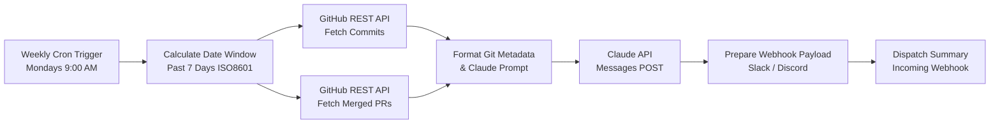

# Weekly Dev Summary Skill & n8n Workflow

Automates executive and engineering weekly progress digests by aggregating GitHub commits and merged PRs for the past 7 days, synthesizing them with the Claude API (Anthropic Messages API), and broadcasting them to a Slack or Discord webhook.

---

## 🏗 Architecture & Workflow Topology

The n8n workflow (`workflows/n8n-weekly-dev-summary.json`) executes on a linear-directed acyclic graph (DAG):

---

## 📦 Node Descriptions & Logic

1. **Weekly Cron Trigger (Mondays 9AM)** (`n8n-nodes-base.scheduleTrigger`):
   - Triggers every Monday at 09:00 UTC (cron: `0 9 * * 1`).
2. **Calculate Date Window (7 Days)** (`n8n-nodes-base.code`):
   - Computes `since` ($T - 7\text{ days}$) and `until` ($T$) in ISO 8601 UTC strings.
   - Extracts target repository and branch parameters from environment variables.
3. **Fetch Recent Commits** (`n8n-nodes-base.httpRequest`):
   - Calls `GET https://api.github.com/repos/{owner}/{repo}/commits?since={since}&until={until}&per_page=100`.
   - Authenticated with `github_auth` (Bearer/Token Header).
4. **Fetch Merged PRs** (`n8n-nodes-base.httpRequest`):
   - Calls `GET https://api.github.com/repos/{owner}/{repo}/pulls?state=closed&sort=updated&direction=desc&per_page=100`.
   - Authenticated with `github_auth`.
5. **Format Git Metadata & Prompt** (`n8n-nodes-base.code`):
   - Filters PRs merged strictly within the 7-day window.
   - Extracts commit SHAs, authors, and summary messages.
   - Constructs a structured prompt directing Claude to generate an executive report with:
     - 🚀 Executive Summary
     - 🌟 Key Features & Enhancements
     - 🐛 Bug Fixes & Maintenance
     - 📊 Metrics & Activity
     - 🔮 Upcoming Focus / Notes
6. **Claude API (Messages API)** (`n8n-nodes-base.httpRequest`):
   - `POST https://api.anthropic.com/v1/messages`
   - Model: `claude-3-7-sonnet-20250219` (or `claude-3-5-sonnet-20241022`)
   - Headers: `x-api-key`, `anthropic-version: 2023-06-01`, `content-type: application/json`.
7. **Prepare Webhook Payload** (`n8n-nodes-base.code`):
   - Formats Markdown output into Slack mrkdwn or Discord content JSON schemas.
8. **Dispatch Summary to Webhook** (`n8n-nodes-base.httpRequest`):
   - `POST {NOTIFICATION_WEBHOOK_URL}` with JSON body payload.

---

## ⚙️ Environment Variables & Setup

Create a `.env` file or define these environment variables in your n8n runtime environment:

| Variable | Description | Example |
|---|---|---|
| `GITHUB_REPO_OWNER` | GitHub organization or username | `octocat` |
| `GITHUB_REPO_NAME` | GitHub repository name | `Spoon-Knife` |
| `GITHUB_BRANCH` | Default target branch (optional) | `main` |
| `GITHUB_TOKEN` | GitHub Personal Access Token (`repo` scope) | `ghp_xxxxxxxxxxxx` |
| `ANTHROPIC_API_KEY` | Anthropic Claude API Key | `sk-ant-api03-...` |
| `NOTIFICATION_WEBHOOK_URL` | Incoming Webhook URL (Slack or Discord) | `https://hooks.slack.com/services/...` |

---

## 🚀 How to Import into n8n

1. Open your n8n Web UI.
2. In the top-right menu, select **Workflows** -> **Import from File...**.
3. Select `workflows/n8n-weekly-dev-summary.json`.
4. Set up the `GitHub Token Header` credential under n8n Credentials (`Header Auth`: `Authorization: Bearer <GITHUB_TOKEN>`).
5. Ensure environment variables or workflow node expressions match your credentials.
6. Activate the workflow toggle.
