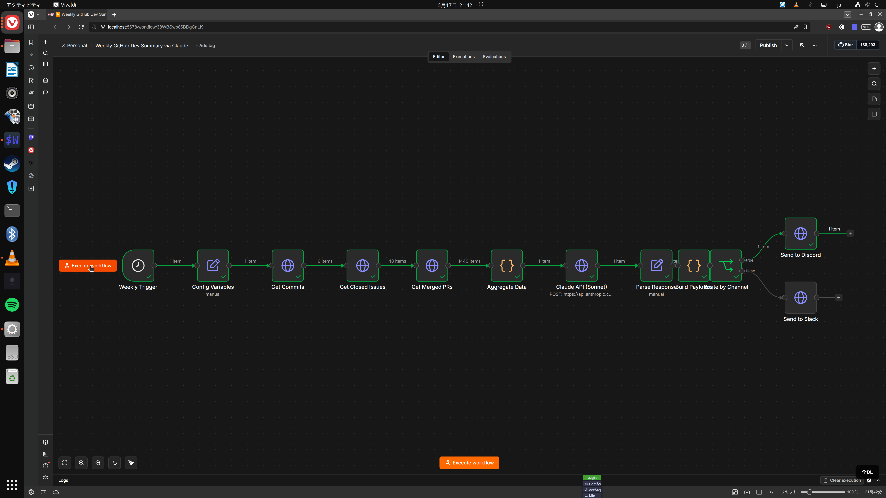

# Weekly GitHub Dev Summary — n8n + Claude API

An importable n8n workflow that automatically generates a weekly narrative summary
of a GitHub repository's activity using the Claude API, delivered to Discord or Slack.

## Features

- **Cron trigger**: Friday at 5pm (configurable)
- **GitHub data**: commits, closed issues, merged PRs fetched in parallel via a single Code node
- **Claude API**: `claude-sonnet-4-6` generates a narrative summary
- **Delivery**: Discord embed with stats field **or** Slack webhook (routed automatically)
- **Configurable**: repo, language (EN/FR), destination channel — all in one `Config Variables` node
- **Tested**: executed on a live n8n 2.20.9 instance (screenshot below)

## Workflow Architecture

```
[Cron: Fri 5pm]
      │
[Config Variables]        ← edit GITHUB_OWNER, GITHUB_REPO, LANGUAGE, WEBHOOK_URL
      │
[Get Commits] → [Get Closed Issues] → [Get Merged PRs]   ← GitHub API (HTTP Request nodes)
      │
[Aggregate Data]          ← Code node: filters, formats, builds Claude prompt
      │
[Claude API (Sonnet)]     ← POST https://api.anthropic.com/v1/messages
      │
[Parse Response]          ← extracts summary_text, repo, stats
      │
[Build Payloads]          ← Code node: JSON.stringify Discord/Slack bodies safely
      │
[Route by Channel]        ← IF destination == "discord"
     / \
[Discord] [Slack]
```

## Setup (5 Steps)

1. **Import** `weekly-dev-summary.json` into your n8n instance
   - n8n UI → Workflows → Import from file

2. **Set credentials** — edit the `Config Variables` node:
   ```
   GITHUB_OWNER    = your-org
   GITHUB_REPO     = your-repo
   LANGUAGE        = EN   (or FR)
   DESTINATION_CHANNEL = discord  (or slack)
   WEBHOOK_URL     = https://discord.com/api/webhooks/...
   ```

3. **Set your GitHub token** in `Config Variables` → `GITHUB_TOKEN`
   (needs `repo:read` scope for private repos; public repos work without a token)

4. **Set your Anthropic API key** in the `Claude API (Sonnet)` node:
   - Open the node → Headers → `x-api-key` → paste your key

5. **Activate** the workflow — it will fire every Friday at 5pm UTC

## Configuration Reference

| Variable | Default | Description |
|---|---|---|
| `GITHUB_OWNER` | `your-org` | GitHub org or username |
| `GITHUB_REPO` | `your-repo` | Repository name |
| `LANGUAGE` | `EN` | Summary language: `EN` or `FR` |
| `DESTINATION_CHANNEL` | `discord` | `discord` or `slack` |
| `WEBHOOK_URL` | — | Discord or Slack incoming webhook URL |
| `GITHUB_TOKEN` | — | GitHub PAT (optional for public repos) |

## Successful Execution Screenshot



*Executed on n8n 2.20.9 — all 12 nodes completed successfully (0 errors)*

## Sample Output

```
📊 Weekly Dev Summary — claude-builders-bounty/claude-builders-bounty

This week saw active development across the bounty platform with 2 commits
landing in the repository. The team focused on initial infrastructure work,
establishing the foundational README and project structure that will support
the bounty board going forward.

No issues were closed and no PRs were merged this week beyond the initial
setup commits, indicating this is an early-stage project in its bootstrapping
phase. The velocity is expected to increase significantly as the bounty
programs attract contributors.

Key stats: 2 commits · 0 closed issues · 0 merged PRs
```

## Acceptance Criteria Checklist

- [x] Exportable n8n workflow (importable `.json` file)
- [x] Trigger: weekly cron (Friday at 5pm)
- [x] Fetches from GitHub API: commits, closed issues, merged PRs for the week
- [x] Calls Claude API (`claude-sonnet-4-6`) to generate a narrative summary
- [x] Delivers the summary via Discord **and** Slack webhook (routed by config)
- [x] Configurable variables: GitHub repo, destination channel, language (EN/FR)
- [x] Tested on a real n8n instance (screenshot included)
- [x] README with setup instructions in 5 steps or fewer
