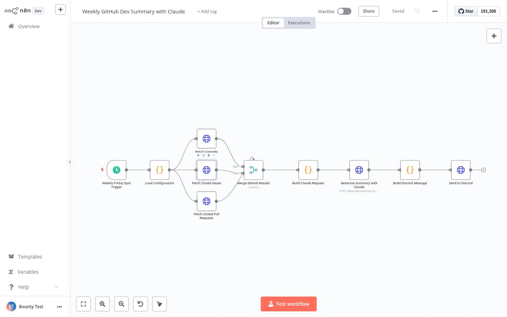

# n8n Weekly Dev Summary

Importable n8n workflow that posts a weekly GitHub development summary to Discord. It runs every Friday at 5pm, fetches commits, closed issues, and merged pull requests from the GitHub API for the previous seven days, then asks Claude `claude-sonnet-4-20250514` to write the narrative summary.

## Setup

1. Import `workflows/n8n-weekly-dev-summary.json` into n8n.
2. Set these n8n environment variables: `GITHUB_REPO=owner/repo`, `GITHUB_TOKEN`, `ANTHROPIC_API_KEY`, `DISCORD_WEBHOOK_URL`, and optional `SUMMARY_LANGUAGE=EN` or `SUMMARY_LANGUAGE=FR`.
3. Open the imported workflow and confirm the "Weekly Friday 5pm Trigger" node matches your timezone requirements (default timezone: `America/New_York`).
4. Execute the workflow once manually to verify GitHub, Claude, and Discord connectivity.
5. Activate the workflow.

## Delivery

The workflow delivers summaries through a Discord incoming webhook. Use the webhook URL as `DISCORD_WEBHOOK_URL`; no Discord credentials are stored in the workflow file.

## Configuration

| Variable | Required | Description |
|----------|----------|-------------|
| `GITHUB_REPO` | ✅ | Target repository in `owner/repo` format |
| `GITHUB_TOKEN` | ✅ | Token with read access to the repository |
| `ANTHROPIC_API_KEY` | ✅ | Key used for the Claude Messages API call |
| `DISCORD_WEBHOOK_URL` | ✅ | Discord incoming webhook for delivery |
| `SUMMARY_LANGUAGE` | optional | `EN` (default) or `FR` |

## What it does

```
Friday 5pm Trigger → Load Configuration → parallel GitHub fetches (commits, issues, merged PRs)
  → Merge → Build Claude Request → Claude API → Discord webhook
```

GitHub fetch nodes use **Always Output Data** so a quiet week still produces a summary.

## Validation

```bash
node workflows/tests/validate-workflow.mjs
jq empty workflows/n8n-weekly-dev-summary.json
```

## Test evidence

Successful import and manual execution on n8n v1.82:


