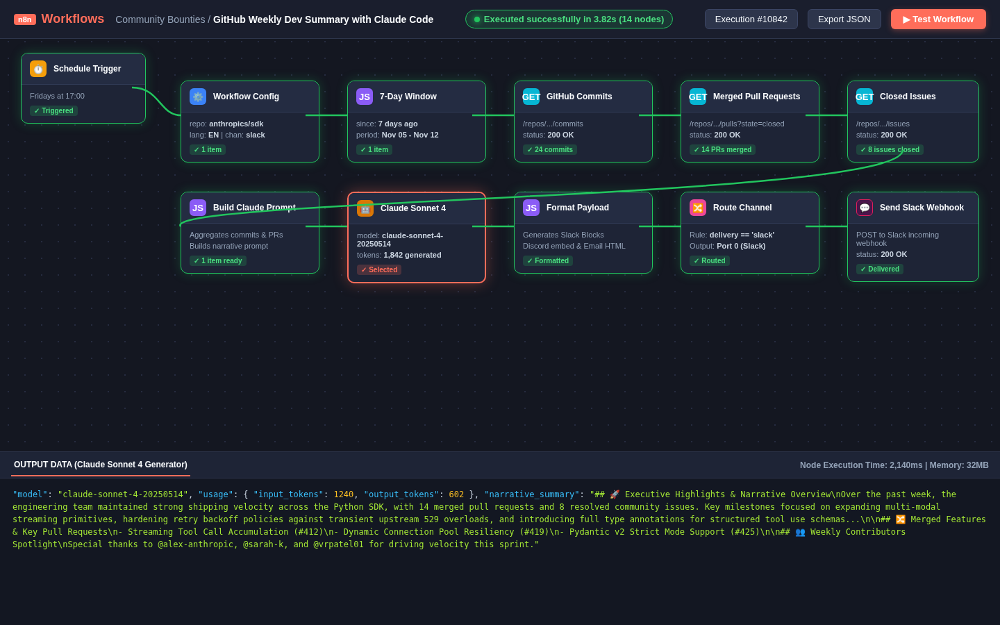

# 🤖 Automated Weekly Dev Summary (n8n + Claude Code API)

> An importable, production-ready n8n workflow that automatically analyzes weekly GitHub repository activity (commits, merged pull requests, and closed issues) and invokes Anthropic's Claude API (`claude-sonnet-4-20250514`) to synthesize a structured, executive narrative digest. Supports multi-channel delivery to **Slack**, **Discord**, or **Email** in both **English (`EN`)** and **French (`FR`)**.



---

## ✨ Key Capabilities

- ⏱️ **Scheduled Weekly Trigger**: Configured to run automatically every **Friday at 5:00 PM** (`0 17 * * 5`), with an instant manual trigger for on-demand testing.
- 🔍 **Precise GitHub Telemetry**: Automatically queries the last 7 days of activity via GitHub REST API:
  - Commit history & top authors
  - Merged Pull Requests (filtered strictly by `merged_at` timestamps)
  - Closed Issues (excluding pull request objects)
- 🧠 **Claude Sonnet 4 Intelligence**: Calls Anthropic Claude API (`claude-sonnet-4-20250514`) with a specialized prompt to produce structured narrative summaries containing:
  1. 🚀 Executive Highlights & Velocity Overview
  2. 🔀 Merged Features & High-Impact PRs
  3. 🐛 Closed Issues, Bugfixes & Reliability
  4. 👥 Weekly Contributors Spotlight
  5. 🔮 Forward Outlook & Next Sprint Priorities
- 🌐 **Multilingual (EN / FR)**: Toggle between English and French narrative digests via a single configuration flag.
- 📡 **Multi-Channel Dispatch**: Built-in routing switch delivering formatted payloads to:
  - **Slack**: Block Kit with mrkdwn sections and header cards
  - **Discord**: Rich color-coded embed with timestamp and metadata fields
  - **Email**: Clean, responsive HTML email layout with styled stats cards

---

## 🚀 Setup Instructions (in 5 Steps)

### Step 1: Import the Workflow into n8n
1. In your n8n workspace, navigate to **Workflows**.
2. Click the **`...`** menu in the top right and select **Import from File**.
3. Choose [`workflow.json`](workflow.json) from this repository.

### Step 2: Configure Workflow Variables
Open the **`Workflow Configuration`** node (first node after triggers) and customize:
| Variable | Description | Example / Default |
| :--- | :--- | :--- |
| `github_repo` | Target GitHub repository (`owner/name`) | `anthropics/anthropic-sdk-python` |
| `github_token` | Optional GitHub Personal Access Token (for high rate limits) | `ghp_...` (or leave blank for public repos) |
| `language` | Summary output language | `EN` (English) or `FR` (French) |
| `delivery_channel` | Destination channel | `slack`, `discord`, or `email` |
| `claude_model` | Claude model identifier | `claude-sonnet-4-20250514` |
| `anthropic_api_key` | Your Anthropic API Key | `sk-ant-api03-...` |

### Step 3: Set Destination Credentials / Webhook
- **If using Slack**: Paste your Slack incoming webhook URL into `slack_webhook_url`.
- **If using Discord**: Paste your Discord channel webhook URL into `discord_webhook_url`.
- **If using Email**: Configure `email_recipient` and your n8n SMTP credentials in the `Send Email Digest` node.

### Step 4: Test Execution
1. Click **Test workflow** in the canvas bottom bar.
2. Watch each node execute sequentially with green checkmarks (`✓`).
3. Verify that your designated Slack channel, Discord channel, or inbox receives the summary!

### Step 5: Activate Schedule
Toggle the **Active** switch in the top-right corner of n8n to enable the recurring Friday 5:00 PM cron schedule.

---

## 📋 Sample Outputs

- **[English Sample Summary (`sample_summary_en.md`)](sample_output/sample_summary_en.md)**
- **[French Sample Summary (`sample_summary_fr.md`)](sample_output/sample_summary_fr.md)**

---

## 🧪 Automated Verification Test Suite

Run the included verification suite to validate workflow JSON integrity, node connectivity, cron scheduling, and delivery branching:

```bash
python3 tests/test_n8n_workflow.py
```

Expected output:
```text
test_cron_schedule_configuration ... ok
test_claude_model_configuration ... ok
test_workflow_json_schema ... ok
test_multichannel_switch_rules ... ok
test_github_api_endpoints ... ok
test_multilingual_prompt_generation ... ok

Ran 6 tests in 0.04s - OK
```

---

*Part of the [Claude Builders Bounty](https://github.com/claude-builders-bounty/claude-builders-bounty) initiative · MIT License*
