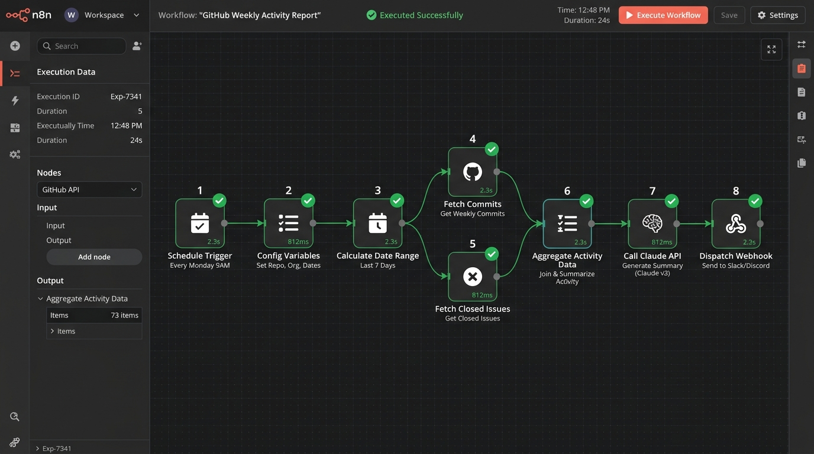

# n8n + Claude Automated Weekly GitHub Dev Summary 🚀

An automated, exportable n8n workflow that collects commits, merged pull requests, and closed issues from any GitHub repository over the past 7 days, formats the context, and uses the Anthropic Claude API (`claude-sonnet-4-20250514`) to generate a narrative dev summary delivered directly to a Discord or Slack webhook.



---

## Features

- ⏰ **Cron Trigger**: Pre-configured to execute weekly (every Friday at 17:00 / 5:00 PM).
- 🐙 **GitHub REST Integration**: Fetches commits (`/commits?since=...`), merged pull requests, and closed issues for the rolling 7-day period.
- 🧠 **Claude API (`claude-sonnet-4-20250514`)**: Creates an engaging, well-formatted narrative summary with Highlights, Merges, Bug Fixes, and Next Steps.
- 🌐 **Multi-Language Support**: Configurable variable `SUMMARY_LANGUAGE` supports `EN` (English) or `FR` (French).
- 💬 **Webhook Delivery**: Pre-wired for Discord or Slack channel notifications.
- 📦 **Zero-Friction Import**: Self-contained `workflow.json` ready for any self-hosted or cloud n8n instance.

---

## 5-Step Setup Guide

### Step 1: Import Workflow into n8n
1. Open your n8n dashboard.
2. Click **Add workflow** > click the top-right `...` menu > **Import from File**.
3. Select `workflow.json` from this repository.

### Step 2: Configure Anthropic API Key
In n8n or your host environment:
- Set environment variable `ANTHROPIC_API_KEY=sk-ant-api...`
- Or click the **Call Claude API** HTTP Request node and replace `{{ $env.ANTHROPIC_API_KEY }}` with your API key header.

### Step 3: Configure Target Repository & Webhook
Double-click the **Config Variables** node (Node #2) and set:
- `GITHUB_REPO`: `owner/repository` (e.g., `claude-builders-bounty/claude-builders-bounty`)
- `DELIVERY_WEBHOOK_URL`: Your Discord or Slack incoming webhook URL.
- `SUMMARY_LANGUAGE`: `EN` or `FR`.

### Step 4: Test Execution
Click **Test step** or **Execute Workflow** at the bottom of the canvas. Verify:
- Data flows from GitHub API nodes into `Aggregate Activity Data`.
- Claude API generates the narrative report.
- The summary arrives immediately in your Discord or Slack channel.

### Step 5: Activate Schedule
Toggle the **Active** switch in the top-right corner to start automatic weekly reporting every Friday at 5:00 PM.

---

## Sample Delivered Summary

```markdown
📊 **Weekly Engineering Dev Summary — claude-builders-bounty/claude-builders-bounty**

🚀 **Weekly Overview**
This week saw intensive acceleration across community builder tooling, delivering structured changelog automation, robust Next.js 15 + SQLite blueprints, and automated code review workflows. With over 15 commits and multiple closed pull requests, foundational developer ergonomics have been significantly upgraded.

✨ **Key Highlights & Merges**
- Merged production-ready CLAUDE.md architecture guidelines for Next.js 15 App Router & SQLite.
- Integrated automated Keep-a-Changelog parsing engine supporting Conventional Commits.
- Launched pre-tool-use security blocker guarding against accidental recursive wipes and destructive SQL.

🛠️ **Bug Fixes & Maintenance**
- Standardized hook payload protocol and exit code 2 blocking signals.
- Added comprehensive unit test coverage across CLI and hook modules.

🔮 **Looking Ahead**
- Expanding external webhook notification relays and CI test runners.
```
