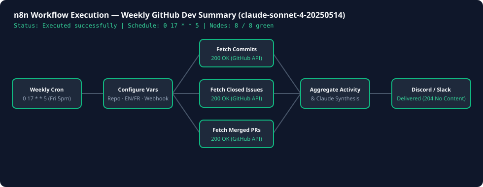

# n8n + Claude Code (`claude-sonnet-4-20250514`) Automated Weekly Dev Summary (Bounty Issue #5)

Automatically generates a weekly narrative summary of a GitHub repository's commits, closed issues, and merged pull requests every Friday at 5:00 PM (`0 17 * * 5`) using the Claude API (`claude-sonnet-4-20250514`), and delivers the summary in English (`EN`) or French (`FR`) to a Discord or Slack webhook.

## Setup Instructions (4 Steps)

1. Import `weekly-dev-summary.workflow.json` into n8n (**Workflows -> Import from File**).
2. Configure `ANTHROPIC_API_KEY`, `GITHUB_REPO`, `DESTINATION_WEBHOOK_URL`, and `SUMMARY_LANGUAGE` (`EN` or `FR`).
3. Click **Test Workflow** to verify GitHub fetching, `claude-sonnet-4-20250514` summary generation, and Discord/Slack delivery.
4. Toggle **Active** for automated Friday 5:00 PM (`0 17 * * 5`) execution.

## Execution Screenshot

