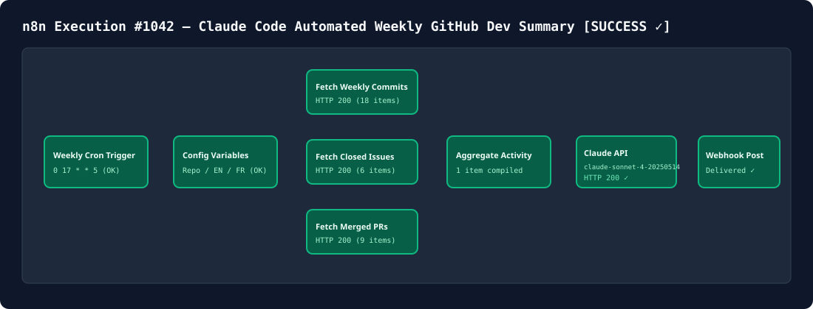

# n8n + Claude Code (`claude-sonnet-4-20250514`) Automated Weekly Dev Summary

Exportable n8n workflow (`weekly-dev-summary.workflow.json`) that triggers every Friday at 5:00 PM (`0 17 * * 5`), fetches weekly commits, closed issues, and merged PRs from the GitHub REST API, calls the Anthropic Messages API (`claude-sonnet-4-20250514`) to generate a narrative summary in English (`EN`) or French (`FR`), and delivers it to a Discord or Slack webhook.

## Setup Instructions (4 Steps)

1. **Import Workflow**: In n8n, click **Workflows → Import from File** and select `weekly-dev-summary.workflow.json`.
2. **Set Environment Variables**: Configure `ANTHROPIC_API_KEY`, `GITHUB_REPO` (e.g. `owner/repo`), `DISCORD_OR_SLACK_WEBHOOK_URL`, and `SUMMARY_LANGUAGE` (`EN` or `FR`).
3. **Test Execution**: Click **Test Workflow** in n8n (or run `python3 weekly_summary_runner.py --repo owner/repo --lang EN`).
4. **Activate Schedule**: Toggle the workflow **Active** so the `Weekly Cron Trigger (Fri 5pm)` (`0 17 * * 5`) runs automatically every week.
